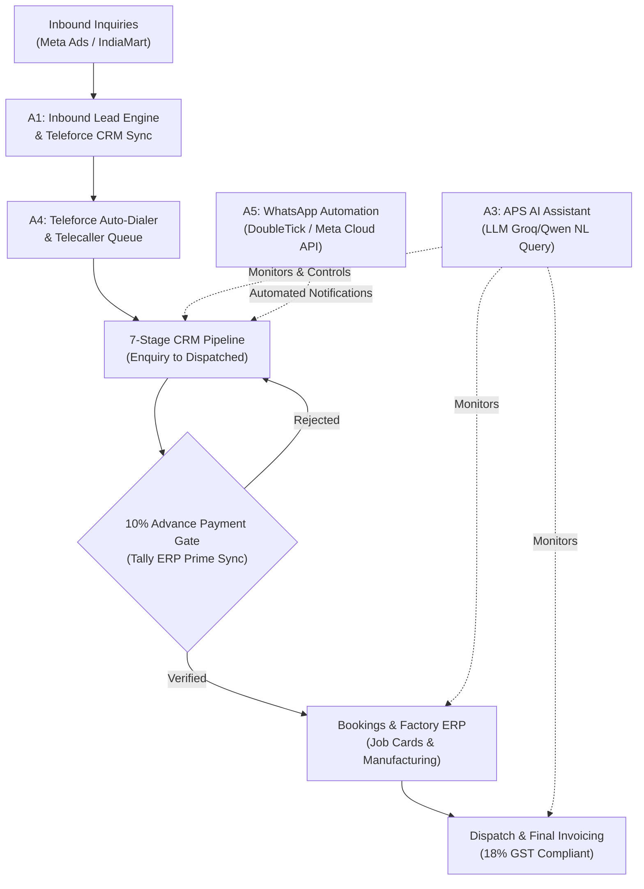

# APS ENTERPRISE — COMPLETE SYSTEM & PRODUCT DOCUMENTATION
**Machinery Manufacturing ERP, Intelligent CRM & Automated AI Operations Suite**

---

## 📌 1. EXECUTIVE SUMMARY & BUSINESS CONTEXT

**APS Enterprises** is an industrial manufacturing powerhouse specializing in high-performance paper converting and packaging machinery (Fully Automatic Double Die Dona Pattal Machines, Hydraulic Paper Plate Presses, Paper Cup Machines, and Roll Cutters).

**APS Enterprise System** is a unified, cloud-ready Operating System designed to automate and streamline the company's complete end-to-end business lifecycle:
* **Inbound Lead Acquisition & CRM** (Meta Ads, IndiaMart, Teleforce CRM).
* **Automated Customer Qualification** (Voice AI Agent & Smart Priority Dialer).
* **Strict 10% Advance Payment Financial Gate** (Guaranteed ledger verification before factory build).
* **Factory Floor ERP Production & Job Cards** (Manufacturing assembly milestones).
* **Enterprise Accounting Bridge** (Tally Prime / Tally ERP 9 XML sync & 18% GST Invoicing).
* **Omnichannel WhatsApp Automation** (DoubleTick / Meta Cloud API customer triggers).
* **APS AI Assistant (A3)** (Natural language query engine in Hindi, English, and Hinglish with role-based chat privacy).

---

## 🏗️ 2. SYSTEM ARCHITECTURE & 5 CORE PILLARS



| Pillar Code | Name | Primary Function |
| :--- | :--- | :--- |
| **A1** | **Inbound Voice & Lead Ingestion** | Ingests leads from Meta/IndiaMart, cleans phone numbers, syncs live with Teleforce CRM. |
| **A2** | **Enterprise ERP & Core Operations** | Manages CRM pipeline, bookings, machine inventory, and job card manufacturing milestones. |
| **A3** | **APS AI Assistant (Deep Intelligence)** | LLM natural-language engine answering stock, revenue, leads, and tasks in Hindi/English/Hinglish. |
| **A4** | **Teleforce Priority Dialer** | Prioritizes hot prospects, manages telecaller calling queue, and logs call recordings. |
| **A5** | **WhatsApp Notification Engine** | Sends automated payment reminders, catalogs, and dispatch notifications via DoubleTick/Meta. |

---

## ⚡ 3. COMPLETE FEATURE BREAKDOWN

### 3.1. 7-Stage Lead Management CRM
A Kanban and tabular CRM pipeline strictly enforcing APS Enterprises' business transition logic:
1. **Enquiry:** Fresh inquiry captured from Meta Ads, IndiaMart, or direct web dialer.
2. **Qualified:** Customer interest, plant shed readiness, and machinery model verified.
3. **Booked:** Quotation accepted; customer issued proforma invoice.
4. **Confirmed Lead:** Lead locked awaiting advance payment.
5. **Client (Paid):** **Locked Gate.** Can only be entered after 10% advance is verified via Tally ERP.
6. **In Production:** Factory job card created; raw materials allocated on shop floor.
7. **Dispatched:** Machine assembled, tested, packaged, and shipped via logistics.

### 3.2. Mandatory 10% Advance Payment Security Gate
* **Zero Optimistic Bypasses:** The system blocks staff from marking a lead as *Client (Paid)* or starting factory production unless at least **10% of machine budget** is verified against the accounting ledger.
* **Dual-Approval / Countersign Policy:** For high-value machinery deals (configurable in System Settings), a second manager/admin signature is mandatory before production release.

### 3.3. Factory ERP & Job Card Management
* **Assembly Floor Tracking:** Generates unique Job Cards (`JC-0992`, etc.) linked to the client's verified booking.
* **Production Milestones:** Tracks frame fabrication, motor fitting, hydraulic pressure testing, electrical panel wiring, and final trial runs.
* **Inventory Allocation:** Deducts raw stock (die sets, crank motors, hydraulic cylinders) in real-time.

### 3.4. APS AI Assistant (A3 Engine)
* **Trilingual Processing:** Understands Hindi, English, and Hinglish queries seamlessly (e.g., *"Rajesh Sharma ka 10% advance aaya kya?"* or *"Show all hot leads for Dona machine"*).
* **Role-Based Access Control (RBAC):**
  - **Employee View:** Can only view their own assigned leads, personal follow-ups, and product specs. Financial summaries and company revenue are strictly stripped.
  - **Admin View:** Full access to revenue, profit margins, team KPI audits, and system configuration.
* **Chat Privacy:** Isolated session memory per user ID; telecallers cannot see each other's chat histories.

### 3.5. Smart Auto-Dialer & Telephony Queue
* **Priority Sorting:** Leads are dynamically weighted (`Hot > High > Normal > Low`) based on budget, machine type, and recent engagement.
* **Teleforce Cloud Bridge:** Dialing requests push straight to Teleforce API with authenticated bearer credentials (`client_id`, `client_secret`, `x-teleforce-secret`, and exact `leadid` syntax).

### 3.6. WhatsApp Business Automation (DoubleTick & Meta Cloud API)
* **Automated Trigger Sequences:**
  - *CATALOG_BROCHURE:* Triggered on Enquiry.
  - *PAYMENT_REMINDER:* 10% advance bank details sent to Booked leads.
  - *PRODUCTION_KICKOFF:* Sent when machine assembly begins.
  - *DISPATCH_NOTICE:* Sent with logistics docket number and machine dispatch video.

### 3.7. Tally ERP Prime Accounting & Invoicing Bridge
* **Real-time XML Parsing:** Connects to local Tally Prime / Tally 9 via port `9000` to verify receipt vouchers.
* **18% GST Compliant Invoices:** Generates standardized GST tax invoices with HSN codes, SGST/CGST breakdown, and printable PDF formats.

### 3.8. Google Tasks Workspace Integration
* **Two-Way Synchronization:** Follow-ups created in APS CRM sync into Google Tasks for mobile reminders.
* **Quick Add & Lead Linking:** Directly link tasks to machine leads with priority flags and due dates.

---

## 👥 4. USER ROLES & PERMISSION MATRIX (TEAM HIERARCHY)

APS Enterprise enforces strict Role-Based Access Control (RBAC) across four primary roles:

| Module / Page | Super Admin (`admin`) | Operations Manager (`manager`) | Accountant (`accountant`) | Sales Rep / Telecaller (`employee`) |
| :--- | :---: | :---: | :---: | :---: |
| **Executive Dashboard** | Full Access | Full Access | No Access | No Access |
| **CRM Leads Pipeline** | Full Access | Full Access | View & Read | Assigned Leads Only |
| **Bookings & ERP Production** | Full Access | Full Access | View Payments | View Linked Status |
| **10% Payment Gate** | Override / Approve | Approve | Full Verification | View Status Only |
| **APS AI Assistant** | Full Financials | Team Operational Data | Finance & Invoices | My Leads & Specs Only |
| **Dialer Queue & Calls** | Full Admin Audit | Monitor & Queue | No Access | Assigned Calling Queue |
| **WhatsApp Automation** | Manage Templates | Monitor Campaigns | No Access | Send Single Template |
| **Tally Sync & Invoices** | Full Access | View Invoices | Full Access & Voucher Sync | No Access |
| **Team KPIs & Performance** | Full Audit | Team Tracking | No Access | Personal Stats Only |
| **Security Activity Logs** | View All Logs | View Ops Logs | View Financial Logs | No Access |
| **System Settings & API Keys** | Full Control | No Access | No Access | No Access |

---

## 🎨 5. UI/UX DESIGN SYSTEM & THEME ARCHITECTURE

The APS Enterprise user interface is crafted around a **Modern Slate Industrial Aesthetic** designed for high information density, low eye strain, and tactile feedback.

### 5.1. Design Tokens & Palette

```
Background Primary   : #f8fafc (Subtle Slate White)
Card / Surface White : #ffffff (Pure Elevated White)
Dark Accent / Hero   : #09090b (Deep Zinc / Pitch Charcoal)
Border Subsystem     : #e4e4e7 / #cbd5e1 (Crisp Hairline Dividers)
Brand Primary (Blue) : #2563eb (Precision Cobalt Blue)
Status Success       : #10b981 (Emerald Green — Verified / Dispatched)
Status Warning       : #f59e0b (Amber — Pending Payment / Countersign)
Status Danger        : #ef4444 (Crimson — Overdue / Rejected)
```

### 5.2. Typography System
* **Headings & Badges:** `Outfit` (Geometric, clean, industrial weights 600, 700, 800).
* **Data Tables & Body Text:** `Plus Jakarta Sans` (Exceptional readability at 11px to 14px sizes).

### 5.3. Layout Philosophy
* **Collapsible Precision Sidebar:** Groups features into `PLATFORM`, `OPERATIONS`, `AI AGENTS`, `FINANCE`, and `PRODUCTIVITY`.
* **Sticky Filter & Metric Bars:** Keeps live operational KPIs pinned to the screen top while tables scroll smoothly.
* **Persistent AI Drawer:** The APS AI Assistant panel is accessible on every page via a floating launch trigger.

---

## 🔒 6. SECURITY & DEPLOYMENT ARCHITECTURE

1. **Authentication:** Cryptographic JWT tokens (`HS256`) with strict session timeout and automatic token rotation.
2. **Database Layer:** Dual-layer architecture:
   - **Primary:** Supabase PostgreSQL with SSL encryption and Sequelize ORM.
   - **Fallback:** Resilient in-memory and disk-backed atomic JSON storage (`safeStorage.js`) ensuring zero downtime during cloud network glitches.
3. **Audit Trail:** Every lead state change, dialer trigger, and voucher export is stamped with Employee ID, Timestamp, IP, and Request ID in the Activity Log.
4. **Git & Environment Hygiene:** Strict `.gitignore` rules shielding `.env`, token JSONs, and proprietary machine blueprints from version control.

---

## 📈 7. OPERATIONAL SUMMARY (AT A GLANCE)

* **Backend Services:** Node.js, Express, Sequelize PostgreSQL, Groq AI SDK, Axios Teleforce Bridge.
* **Frontend Client:** React 18, Vite, React Router 6, Canvas Charting, Modular CSS Variables.
* **Third-Party Bridges:** Teleforce (CRM & Dialer), DoubleTick (WhatsApp), Tally Prime (XML 9000), Google Tasks (OAuth 2.0).
* **Test Coverage:** 179 Automated Unit, Contract & Integration Tests (100% Passing).

